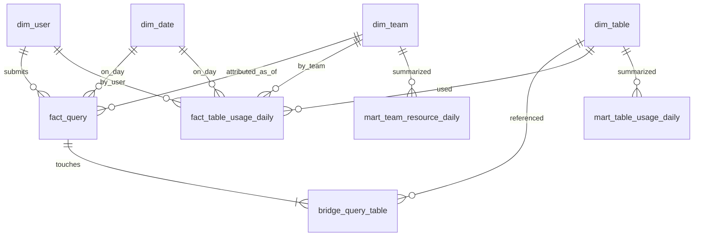

# Part 1 — Meta DWH design

## 1. Problem

We collect raw events from a Trino cluster and store analytical datasets as Apache Iceberg tables on Amazon S3. We need a **Meta DWH**: a small warehouse that describes **how those tables are used**, not the product events inside them.

Primary questions:

1. How many **distinct users** queried table **X** during a given period?
2. How many **resources** did team **Y** consume during that period?

Finding the answer once is not enough. We need **daily history** so usage and cost trends are visible over time.

---

## 2. Design goals

- Answer the two questions above with simple, stable SQL.
- Keep **query-level truth** (what really ran) separate from **table-level attribution** (how we allocate cost across tables).
- Support **incremental daily loads** and **bounded backfills**.
- Stay small enough for a take-home, but shaped like something a production data platform would extend.

Non-goals for this assignment:

- Building a full company-wide data catalog / OpenLineage platform.
- Perfect SQL parsing for every Trino dialect edge case.
- Exact dollar cloud billing (we use Trino resource proxies).

---

## 3. Assumptions

Documented assumptions reviewers can challenge or refine.

### 3.1 Source of usage

| Assumption | Detail |
|------------|--------|
| A1 | Trino exposes query history (or an event listener dump) with one row per query attempt. |
| A2 | For each finished/failed query we know: `query_id`, user, timestamps, state, CPU/wall time, bytes scanned, peak memory, output rows/bytes. |
| A3 | Accessed relations are available either as structured `accessed_tables[]` in the event, or can be derived from the query text / analyzer output. Prefer structured lists when present. |
| A4 | We only track **Iceberg tables in our analytical catalogs** (e.g. `analytics`, `lake`). Internal Trino system tables are ignored. |

### 3.2 Users and teams

| Assumption | Detail |
|------------|--------|
| A5 | Every interactive/service principal maps to a `user_id`. Service accounts are users too (e.g. `svc-dbt-analytics`). |
| A6 | Team membership comes from an HR/org snapshot: `user_id → team_id`, valid for a time range (SCD2 or daily snapshot). |
| A7 | A query is attributed to the user’s team **as of `query_started_at`**, not the current team today. |
| A8 | If team is missing, `team_id = 'unknown'` and resource marts still include the row (do not drop cost). |

### 3.3 Multi-table queries

| Assumption | Detail |
|------------|--------|
| A9 | One query may read/write **N tables**. Popularity metrics (distinct users, query count) count the query **once per touched table** without splitting. |
| A10 | Resource metrics attributed **to tables** use **equal weight** `1/N` across distinct accessed tables in that query (default). |
| A11 | If a future input provides per-table bytes from the query plan / Iceberg scan metrics, replace equal split with measured shares; keep `attribution_method` on the bridge table. |
| A12 | We do **not** allocate 100% of query cost to every table (that double-counts). Team resource totals always come from **query-level** metrics to avoid double-counting across tables. |

### 3.4 What counts as “queried”

| Assumption | Detail |
|------------|--------|
| A13 | States `FINISHED` and `FAILED` both count for usage (failed queries still consumed resources and touched metadata/data). |
| A14 | `QUEUED` / `RUNNING` incomplete events are excluded until a terminal state arrives. |
| A15 | `INSERT`/`MERGE`/`CREATE TABLE AS` targets are included as accessed tables with `access_type` set accordingly. |

### 3.5 Time and history

| Assumption | Detail |
|------------|--------|
| A16 | Business calendar is UTC. Daily grain uses `date(query_started_at)` in UTC. |
| A17 | Historical perspective = append-only query facts + rebuildable daily marts. |
| A18 | Late events: incremental job reprocesses a **2-day lookback** window each run. |

---

## 4. Additional metadata we need

If not already in Trino history, maintain these side inputs:

### 4.1 `meta_user_team_scd` (org mapping)

| Column | Type | Description |
|--------|------|-------------|
| user_id | string | Principal id |
| team_id | string | Team id |
| team_name | string | Display name |
| valid_from | timestamp | Inclusive |
| valid_to | timestamp | Exclusive; `null` = current |
| is_current | boolean | Convenience flag |

**Use:** join to `fact_query` on `user_id` and `started_at >= valid_from AND (valid_to IS NULL OR started_at < valid_to)`.

### 4.2 `meta_table_catalog` (optional but valuable)

| Column | Type | Description |
|--------|------|-------------|
| table_id | string | Surrogate / hash of fqn |
| table_fqn | string | `catalog.schema.table` |
| layer | string | `raw` / `stage` / `mart` / unknown |
| owner_team_id | string | Data owner (≠ consumer team) |
| description | string | Human/AI-oriented description |
| is_iceberg | boolean | Filter for in-scope tables |

**Use:** enrich marts, filter to Iceberg-only, help AI agents discover trusted datasets. Ownership is **not** used for consumption attribution.

---

## 5. Proposed tables

### 5.1 Layering

```text
Sources (external)
  trino_query_history
  trino_query_accessed_tables   -- or parsed from SQL
  meta_user_team_scd
  meta_table_catalog

Staging
  stg_trino_query
  stg_trino_query_table

Core dimensions
  dim_date
  dim_user
  dim_team
  dim_table

Core facts / bridges
  fact_query                 -- grain: 1 row = 1 query
  bridge_query_table         -- grain: 1 row = 1 (query, table)
  fact_table_usage_daily     -- grain: date × table × user × team

Marts
  mart_table_usage_daily     -- grain: date × table
  mart_team_resource_daily   -- grain: date × team
```

### 5.2 Entity relationship (logical)



### 5.3 Table specs

#### `dim_date`

| Grain | One row per calendar day (UTC) |
|-------|--------------------------------|
| PK | `date_id` (`YYYYMMDD` int) |
| Key fields | `date`, `year`, `month`, `iso_week`, `day_name` |

#### `dim_user`

| Grain | One row per principal |
|-------|------------------------|
| PK | `user_id` |
| Key fields | `user_email`, `user_type` (`human` / `service`), `is_active` |

#### `dim_team`

| Grain | One row per team |
|-------|------------------|
| PK | `team_id` |
| Key fields | `team_name`, `cost_center` (optional) |

#### `dim_table`

| Grain | One row per `catalog.schema.table` |
|-------|-------------------------------------|
| PK | `table_id` |
| Key fields | `table_fqn`, `catalog_name`, `schema_name`, `table_name`, `layer`, `owner_team_id`, `is_iceberg` |

#### `fact_query`

| Grain | One row per Trino `query_id` |
|-------|------------------------------|
| PK | `query_id` |
| FKs | `user_id`, `team_id`, `date_id` |
| Degenerate | `query_state`, `query_source` (JDBC/UI/dbt/…) |
| Metrics (query-level, **no split**) | `cpu_time_ms`, `wall_time_ms`, `bytes_scanned`, `peak_memory_bytes`, `output_rows`, `output_bytes` |
| Derived | `table_count`, `is_failed` |

This table is the **source of truth for team resource consumption** (question 2).

#### `bridge_query_table`

| Grain | One row per (`query_id`, `table_id`) |
|-------|--------------------------------------|
| PK | (`query_id`, `table_id`) |
| Fields | `access_type` (`SELECT`/`INSERT`/`MERGE`/…), `attribution_weight`, `attribution_method` (`equal_split` / `plan_bytes`) |
| Attributed metrics | `attributed_cpu_time_ms`, `attributed_bytes_scanned`, `attributed_peak_memory_bytes` |

Rules:

- `sum(attribution_weight) ≈ 1.0` per `query_id` (tolerance for float).
- Attributed metric = query metric × weight.

#### `fact_table_usage_daily`

| Grain | `date_id × table_id × user_id × team_id` |
|-------|------------------------------------------|
| Metrics | `query_count`, `failed_query_count`, `attributed_cpu_time_ms`, `attributed_bytes_scanned`, `attributed_peak_memory_bytes` |

Built by aggregating `bridge_query_table` ⋈ `fact_query`.  
Used as a flexible base for marts and ad-hoc slices (e.g. “which users drove table X last week”).

#### `mart_table_usage_daily`

| Grain | `date_id × table_id` |
|-------|----------------------|
| Metrics | `distinct_users`, `query_count`, `failed_query_count`, `attributed_cpu_time_ms`, `attributed_bytes_scanned` |

**Directly answers question 1** (sum/avg over a date range; `sum(distinct_users)` across days is **not** period-distinct — see §7).

#### `mart_team_resource_daily`

| Grain | `date_id × team_id` |
|-------|---------------------|
| Metrics | `query_count`, `failed_query_count`, `cpu_time_ms`, `wall_time_ms`, `bytes_scanned`, `peak_memory_bytes_p95` (optional), `distinct_users`, `distinct_tables` |

**Directly answers question 2.** Metrics are aggregated from `fact_query` (not from attributed table metrics) so multi-table queries are counted once.

---

## 6. Resource usage metrics

### 6.1 Why these metrics

Trino does not always give a perfect cloud invoice line per query. We use **engine resource proxies** that are available in query stats and correlate with cost/load:

| Metric | Why it matters |
|--------|----------------|
| `cpu_time_ms` | Compute pressure on the cluster |
| `wall_time_ms` | User-facing latency / slot occupancy |
| `bytes_scanned` | I/O and S3 request/volume driver |
| `peak_memory_bytes` | Memory pressure / spill risk |
| `output_rows` / `output_bytes` | Result size; useful for “heavy SELECT *” detection |
| `query_count` / `failed_query_count` | Adoption and reliability signals |

Optional cost proxy for ranking (not currency):

```text
cost_score = w1 * cpu_time_ms + w2 * bytes_scanned + w3 * peak_memory_bytes
```

Weights can be tuned later from real cloud bills; keep them out of the core facts until calibrated.

### 6.2 Two reporting lenses (important)

| Lens | Use for | Source |
|------|---------|--------|
| **Popularity** | distinct users, “is table X used?” | query↔table presence (no split needed) |
| **Attributed resources (per table)** | “which tables drive scan volume?” | `bridge_query_table` with weights |
| **Consumed resources (per team)** | “what did team Y cost the cluster?” | `fact_query` only |

Mixing lenses without saying so is a common Meta DWH mistake; the model keeps them explicit.

---

## 7. Answering the brief’s questions

### Q1 — Distinct users of table X in period `[d1, d2]`

**Approximate (fast, from mart):**

```sql
SELECT SUM(distinct_users) AS distinct_users_sum_of_daily
FROM mart_table_usage_daily
WHERE table_fqn = 'analytics.mart.table_x'  -- via join to dim_table
  AND date_id BETWEEN :d1 AND :d2;
```

`SUM(daily distinct)` over-counts users active on multiple days.

**Exact period distinct (from daily fact or bridge):**

```sql
SELECT COUNT(DISTINCT user_id)
FROM fact_table_usage_daily f
JOIN dim_table t USING (table_id)
WHERE t.table_fqn = 'analytics.mart.table_x'
  AND f.date_id BETWEEN :d1 AND :d2;
```

We keep **both**: mart for trends/dashboards, fact for exact period distinct.

### Q2 — Resources consumed by team Y in period

```sql
SELECT
  SUM(cpu_time_ms)      AS cpu_time_ms,
  SUM(bytes_scanned)    AS bytes_scanned,
  SUM(wall_time_ms)     AS wall_time_ms,
  SUM(query_count)      AS query_count
FROM mart_team_resource_daily
WHERE team_id = :team_y
  AND date_id BETWEEN :d1 AND :d2;
```

---

## 8. How data would be updated

### 8.1 Cadence

- **Hourly or daily** incremental job (daily is enough for the assignment).
- Input watermark: `max(ended_at)` successfully loaded.
- Each run processes `[watermark - 2 days, now)` for late arrivals, then upserts.

### 8.2 Load pattern

```text
1. Extract new/changed Trino query events → stg_trino_query
2. Extract/normalize accessed tables     → stg_trino_query_table
3. Upsert dimensions (user/table/team)
4. MERGE fact_query on query_id
5. DELETE+INSERT bridge rows for affected query_ids
   (or full replace for those query_ids)
6. Recompute fact_table_usage_daily for touched date_ids
7. Recompute mart_* for touched date_ids
```

### 8.3 Idempotency

- `fact_query`: `MERGE` on `query_id`.
- Daily tables: `INSERT OVERWRITE` partition by `date_id` (Iceberg) or delete+insert for the date set.
- Re-running the same window must not duplicate costs.

### 8.4 Backfill / historical recalculation

When attribution logic changes (e.g. equal split → plan-based bytes):

1. Keep raw staging / source events immutable.
2. Re-run steps 5–7 for the affected date range (or full history).
3. Optionally version `attribution_method` and store run_id in a `etl_watermark` table.

This matches the internship theme: **automation for backfills when logic changes**.

### 8.5 Data quality checks (minimal)

- Every `bridge_query_table.query_id` exists in `fact_query`.
- Per query, `abs(sum(weight) - 1.0) < 1e-6` when `table_count > 0`.
- Queries with `table_count = 0` (parse failure) land in a quarantine metric, not silent drop of team cost.

---

## 9. Design choices — summary

1. **Star/bridge model** over a single wide events table → clear grain, reusable metrics.
2. **Team cost from `fact_query`** → no double-counting when queries hit many tables.
3. **Equal split as default table attribution** → honest, simple, replaceable via `attribution_method`.
4. **As-of team membership** → historically correct trends.
5. **Daily marts + detailed facts** → fast dashboards and exact period-distinct users.
6. **Rebuildable marts from staging** → backfills stay tractable.

---

## 10. Mapping to later implementation parts

| Design object | Implemented in |
|---------------|----------------|
| DDL for dims/facts/marts | Part 2 |
| Sample Trino history + org metadata | Part 2 |
| Staging → fact → mart SQL | Part 3 |
| Example queries for Q1/Q2 | Part 4 |
| Run instructions | Part 5 |

---

## 11. Open points for reviewers / production

- Prefer Trino **event listener** + analyzer relations over brittle regex SQL parsing.
- Replace equal split with **Iceberg scan metrics per table** when available.
- Add row-level lineage later; this Meta DWH starts at **table-level** usage.
- Expose `dim_table` + usage marts to AI agents as “which datasets are real and heavily used.”
